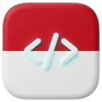

<div align="center">



# 🇮🇩 Paket Bahasa Indonesia untuk Visual Studio Code (Modern)
### *Official-Standard Indonesian Language Pack for Visual Studio Code & Antigravity IDE*

[](https://marketplace.visualstudio.com/items?itemName=mrmarc.vscode-language-pack-id)
[](https://code.visualstudio.com/)
[](translations/main.i18n.json)
[](translations/extensions/)
[](LICENSE)
[](https://github.com/Mrmarc-bit/vscode-language-pack-id)

<p align="center">
  <b>Membuka akses pemrograman bagi seluruh talenta digital, pelajar, dan pengembang perangkat lunak di Indonesia dengan antarmuka yang ramah, baku, dan 100% modern.</b>
</p>

[Fitur Utama](#-fitur-unggulan) •
[Cara Pemasangan](#-cara-pemasangan) •
[Cara Mengaktifkan](#-cara-mengaktifkan-bahasa-indonesia) •
[Glosarium Baku](#-pedoman-terjemahan-glosarium) •
[Panduan Publikasi Marketplace](#-panduan-publikasi-ke-visual-studio-marketplace) •
[Kontribusi](#-kontribusi)

</div>

---

## 💡 Mengapa Proyek Ini Dibangun?

Visual Studio Code adalah editor kode paling populer di dunia. Namun, paket bahasa Indonesia resmi Microsoft sebelumnya (`MS-CEINTL.vscode-language-pack-id`) telah **dihentikan pengembangannya sejak tahun 2020** (terhenti di VS Code v1.48 dengan hanya ~6.000 string) dan diarsipkan ke `vscode-loc-deprecated`.

Akibatnya, pada VS Code versi modern saat ini:
* **Lebih dari 23.000+ string antarmuka baru** tidak memiliki terjemahan sama sekali dan tetap tampil dalam bahasa Inggris.
* Menu bar, menu klik-kanan, dan kotak dialog tampil tidak konsisten dengan campuran kata yang membingungkan pemula.
* Fitur-fitur generasi baru seperti **AI Chat, Agen Otonom, Sesi, Kanvas Interaktif, dan Server MCP** tidak memiliki padanan bahasa Indonesia yang tepat.

Proyek ini dibangun untuk **menghidupkan kembali, memodernisasi, dan memelihara Paket Bahasa Indonesia berstandar resmi** untuk Visual Studio Code dan Antigravity IDE secara berkelanjutan.

---

## ✨ Fitur Unggulan

| Fitur | Cakupan | Penjelasan |
| :--- | :---: | :--- |
| **Terjemahan Inti Lengkap** | **30.566 String** | Mencakup seluruh 2.344 modul inti antarmuka VS Code dari instalasi modern terbaru. |
| **Menu Bar & Mnemonik Presisi** | **100%** | Seluruh menu bar (*Berkas, Ubah, Pilihan, Tampilan, Buka, Jalankan, Terminal, Jendela, Bantuan*) dilengkapi akses cepat keyboard (`&&`). |
| **92 Ekstensi Bawaan Resmi** | **2.131 String** | Ekstensi bawaan seperti *Git, Markdown, TypeScript, Python/Pylance, JSON, HTML, CSS, Emmet*, dan *Debugger* diterjemahkan penuh. |
| **Dukungan AI & Antigravity IDE** | **Lengkap** | Terjemahan khusus untuk menu Obrolan AI, Kustomisasi Agen, Kanvas Interaktif, Server MCP, Kumpulan Alat, dan Migrasi. |
| **Glosarium Standar KBBI & Industri** | **Baku** | Mengacu pada KBBI dan kebiasaan pengembang Indonesia tanpa merusak istilah teknis universal (*Git, Commit, Branch, Terminal, Breakpoint*). |
| **Bebas Dependensi Node / Eksternal** | **Mandiri** | Dilengkapi script python mandiri untuk validasi, build `.vsix`, dan instalasi lokal tanpa memerlukan instalasi npm global. |

---

## 📦 Cara Pemasangan

### Metode 1: Pasang dari Visual Studio Marketplace (Rekomendasi)
1. Buka aplikasi **Visual Studio Code** atau **Antigravity IDE**.
2. Masuk ke tab **Extensions / Ekstensi** (`Cmd + Shift + X` di macOS atau `Ctrl + Shift + X` di Windows/Linux).
3. Cari: `Indonesian Language Pack` oleh `mrmarc`.
4. Klik **Install**.

---

### Metode 2: Pasang Manual Menggunakan Berkas `.vsix`
Jika Anda mengunduh dari rilis GitHub atau ingin memasang secara offline:
1. Unduh berkas **`vscode-language-pack-id-1.144.2.vsix`** dari [Halaman Rilis GitHub](https://github.com/Mrmarc-bit/vscode-language-pack-id/releases) atau dari folder root repositori ini.
2. Di VS Code, buka panel **Ekstensi** (`Cmd + Shift + X` / `Ctrl + Shift + X`).
3. Klik ikon menu titik tiga **`...`** (Views and More Actions) di kanan atas panel Ekstensi.
4. Pilih **Install from VSIX...** (*Pasang dari VSIX...*).
5. Pilih berkas `.vsix` yang telah diunduh.

---

## 🌐 Cara Mengaktifkan Bahasa Indonesia

Setelah paket terpasang, aktifkan bahasa tampilan dengan langkah mudah berikut:

1. Tekan pintasan keyboard:
   * **macOS**: `Cmd + Shift + P`
   * **Windows / Linux**: `Ctrl + Shift + P`
2. Ketik perintah: **`Configure Display Language`** lalu tekan `Enter`.
3. Pilih opsi **`Bahasa Indonesia`**.
4. Klik tombol **Restart** saat muncul notifikasi konfirmasi.
5. 🎉 **Selamat!** Seluruh antarmuka editor Anda kini telah menggunakan Bahasa Indonesia yang bersih dan nyaman.

---

## 📖 Pedoman Terjemahan (Glosarium)

Kami memegang teguh prinsip bahwa antarmuka harus **mudah dipahami pemula tanpa menghilangkan istilah teknis universal**:

| Istilah Asli (English) | Padanan Terjemahan | Konteks & Catatan |
| :--- | :--- | :--- |
| **File / Folder** | **Berkas / Folder** | Sesuai kelaziman KBBI & sistem operasi modern |
| **Workspace** | **Ruang Kerja** | Konsep multi-folder project pada VS Code |
| **Save / Save As / Save All** | **Simpan / Simpan Sebagai... / Simpan Semua** | Tindakan penyimpanan dokumen |
| **Undo / Redo** | **Urungkan / Ulangi** | Tindakan riwayat edit |
| **Command Palette** | **Palet Perintah** | Akses cepat perintah editor (`Cmd/Ctrl+Shift+P`) |
| **Explorer** | **Penjelajah** | Panel manajemen berkas di bilah sisi |
| **Source Control** | **Kontrol Sumber** | Panel integrasi Git / Version Control |
| **Terminal** | **Terminal** | Dipertahankan sebagai istilah baku teknis |
| **Output / Problems** | **Keluaran / Masalah** | Panel log dan deteksi error kode |
| **Breakpoint** | **Titik Henti** | Titik penghentian eksekusi pada debugging |
| **Debug / Debugging** | **Debug / Debugging** | Dipertahankan sebagai istilah baku rekayasa perangkat lunak |
| **Git Commit / Branch / Push / Pull** | **Commit / Cabang / Push / Pull** | Istilah ekosistem Git universal dipertahankan |
| **Canvases / MCP Servers** | **Kanvas / Server MCP** | Istilah antarmuka agen AI modern |

> 📌 Baca pedoman lengkap istilah teknologi di [GLOSSARY.md](GLOSSARY.md).

## 🛠️ Alur Kerja & Pengembangan (*Developer Tools*)

Repositori ini dilengkapi dengan toolchain Python bawaan yang dapat dijalankan tanpa dependensi berat:

```bash
# 1. Validasi sintaks, integritas placeholder ({0}, {1}), dan pendaftaran lokal:
python3 scripts/validate.py

# 2. Sinkronisasi & deteksi string baru dari upstream VS Code Microsoft:
python3 scripts/sync_upstream.py

# 3. Regenerasi terjemahan menyeluruh (Core + 92 Ekstensi):
python3 scripts/generate_ultimate_translation.py

# 4. Bangun paket distribusi .vsix:
python3 scripts/build_vsix.py
```

---

## 📂 Struktur Repositori

```text
├── package.json                          # Manifes ekstensi resmi VS Code Language Pack
├── GLOSSARY.md                           # Pedoman baku istilah teknologi pengembang
├── README.md                             # Dokumentasi resmi proyek
├── LICENSE                               # Lisensi open-source MIT
├── icon.png                              # Ikon resmi paket bahasa (128x128)
├── vscode-language-pack-id-1.144.2.vsix   # Paket biner installer siap pasang
├── translations/
│   ├── main.i18n.json                    # Terjemahan inti VS Code (30.566 string, 2.344 modul)
│   └── extensions/                       # Terjemahan 92 ekstensi bawaan resmi (Git, Debug, dll)
└── scripts/
    ├── build_vsix.py                     # Pemaket mandiri VSIX berbasis zipfile Python
    ├── generate_ultimate_translation.py  # Mesin penerjemah menyeluruh & pembersih hybrid
    ├── install_local.py                  # Skrip penaut instalasi lokal
    ├── validate.py                       # Skrip validasi format & placeholder
    └── sync_upstream.py                  # Skrip pelacak pembaruan upstream Microsoft
```

---

## 🤝 Berkontribusi

Kami sangat mengapresiasi kontribusi dari komunitas pengembang Indonesia untuk terus menyempurnakan keakuratan istilah:

1. **Fork** repositori ini ke akun GitHub Anda.
2. Buat *branch* fitur Anda:
   ```bash
   git checkout -b fitur/penyempurnaan-istilah
   ```
3. Lakukan pengeditan sesuai kaidah di [GLOSSARY.md](GLOSSARY.md).
4. Pastikan validasi berhasil:
   ```bash
   python3 scripts/validate.py
   ```
5. Commit perubahan Anda dan buat **Pull Request** ke repositori utama!

---

## 📄 Lisensi

Proyek ini dilisensikan di bawah [MIT License](LICENSE).  
Hak cipta Visual Studio Code dan ikon globe adalah milik **Microsoft Corporation**.
Dirawat dengan penuh dedikasi oleh **[Maruf Muchlisin](https://github.com/Mrmarc-bit)** dan para kontributor open-source Indonesia.
